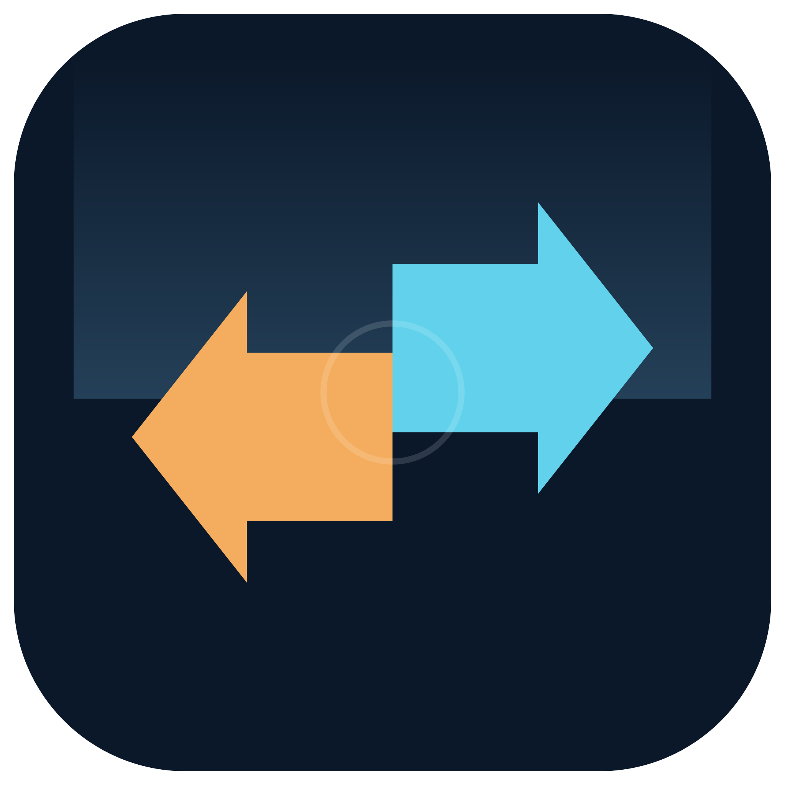
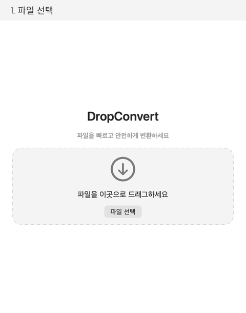

<p align="center"></p>

# DropConvert

**파일 업로드 없이 Mac에서 문서와 이미지를 변환하는 메뉴 막대 앱입니다.**

파일을 선택하거나 끌어다 놓고 출력 형식을 고르면 원본 옆에 결과를 저장합니다.
원본은 수정하지 않고, 같은 이름의 결과가 있으면 번호를 붙입니다.

[**베타 다운로드**](https://github.com/yechan-7942/DropConvert/releases/tag/v0.1.0-beta) · [오류 제보](https://github.com/yechan-7942/DropConvert/issues/new/choose)



실제 SwiftUI 화면 구성으로 재현한 사용 흐름 예시입니다. GIF에는 합성 문서 이름을 사용했습니다.

> **v0.1.0-beta · Apple Silicon용 테스트 빌드**
>
> 개발용 로컬 서명이며 **Apple Developer ID 서명·공증은 적용하지 않았습니다.** macOS가 실행을 차단할 수 있습니다.
> 다른 Mac과 Intel Mac의 설치·실행은 아직 검증하지 않았습니다. HWP 변환의 복잡한 서식은 원본과 달라질 수 있습니다.

## 설치와 사용

1. [Releases](https://github.com/yechan-7942/DropConvert/releases/tag/v0.1.0-beta)에서 `DropConvert-0.1.0-beta-arm64.dmg`를 받습니다.
2. DMG 안의 **DropConvert.app**을 **Applications**로 드래그한 뒤 실행합니다.
3. 메뉴 막대의 양방향 화살표 아이콘을 눌러 파일을 선택하거나 끌어다 놓습니다.
4. 출력 형식을 고르고 **변환하기**를 누릅니다. 완료 후 **Finder에서 열기**로 결과를 확인합니다.

문서 변환을 처음 쓴다면 **문서 변환 준비 → 필요한 기능 설치 → 완료**를 누르세요.
터미널, Homebrew, 시스템 Python 설치 없이 필요한 도구를 사용자 전용 폴더에 준비합니다.
이미지·PDF 이미지 변환은 추가 도구 없이 이용할 수 있습니다.

최초 도구 설치에는 인터넷과 수백 MB의 추가 저장 공간이 필요합니다.
설치 단계를 표시하며, 검증한 다운로드는 재사용하고 실패하면 다시 시도할 수 있습니다.

패널을 닫아도 앱은 메뉴 막대에 남습니다. **종료**를 누르면 종료됩니다.
최초 실행 시 로그인 자동 실행 등록을 시도하며, 패널 하단에서 켜거나 끌 수 있습니다.
macOS 승인이 필요하면 **로그인 항목 설정 열기**에서 상태를 확인할 수 있습니다.

## 지원하는 변환

| 입력 | 출력 | 범위 |
|---|---|---|
| PDF | PNG, JPG | **첫 페이지만** 이미지로 저장 |
| PNG, JPG, HEIC, TIFF, BMP | PDF | 이미지를 PDF 한 페이지로 저장 |
| PNG, JPG, HEIC, TIFF, BMP | PNG, JPG | 같은 형식은 출력 목록에서 제외 |
| Word `.docx` | PDF | 문서 도구 설치 필요 |
| HWP 5 `.hwp` | Word `.docx`, PDF | **베타**, 문서 도구 설치 필요 |
| Word `.docx` | HWP 5 `.hwp` | **베타**, 원문 글자 보존 검사 후 저장 |

한 번에 한 파일을 처리합니다. OCR, PDF → Word, HWPX, HWP 3, PPT·Excel 변환은 제공하지 않습니다.
암호·배포용 보호 문서도 지원 대상으로 삼지 않습니다.

### 한글 문서 품질

- HWP 변환의 글꼴·표·수식·도형·머리말·꼬리말·쪽 배치는 원본과 달라지거나 일부 개체가 누락될 수 있습니다.
- Word → HWP는 결과를 별도 파서로 읽어 원문 문단과 글자의 보존 여부를 확인합니다. 확인하지 못하면 저장을 중단합니다.
- 글자 검사는 공백·줄바꿈과 유니코드 조합형/완성형 차이를 정규화합니다. 글꼴의 실제 표시와 레이아웃까지 보증하는 검사는 아닙니다.
- 원본 글꼴이 없으면 대체될 수 있습니다. 제출·인쇄 전에는 원본과 결과를 비교해 주세요.

## 개인정보와 설치 도구

**문서·이미지 변환 시 원본 파일을 웹사이트에 업로드하지 않습니다.**
도구 설치 때에는 GitHub·PyPI 등 공식 배포처에 접속합니다.

문서 도구는 `~/Library/Application Support/DropConvert/Engines`에 설치하며,
전역 PATH, Homebrew, 시스템 Python과 별도 Filee 앱 설정을 바꾸지 않습니다.
Filee·uv 압축 파일은 고정 SHA256을 확인한 뒤 실행합니다.
Python 패키지는 PyPI에서 설치하며 모든 의존성이 동일한 방식의 체크섬으로 고정된 것은 아닙니다.

기존 LibreOffice가 있으면 이를 이용하고, 없으면 설치된 Filee 엔진으로 문서를 변환합니다.
두 경로 모두 시스템·사용자 글꼴과 macOS 다운로드 글꼴을 찾도록 설정합니다.
사용하는 외부 도구와 출처는 [THIRD-PARTY-NOTICES.md](THIRD-PARTY-NOTICES.md)를 참고하세요.

## YouTube 저장

**YouTube 저장** 탭에서 영상 링크를 넣고 **영상 저장**을 누릅니다.
기본 저장 위치는 바탕화면이며 폴더를 바꿀 수 있습니다. MP4 저장을 우선하며 진행률·중단·완료 상태를 표시합니다.

이 기능은 **yt-dlp와 ffmpeg를 별도 설치**해야 합니다. 문서 도구 자동 설치에는 포함되지 않습니다.

```sh
brew install yt-dlp ffmpeg
```

이 기능은 YouTube에 접속합니다. 로그인·연령·지역 제한 등에 따라 다운로드가 거부될 수 있습니다.
본인이 저장할 권한이 있는 영상에 사용하세요.

## 오류 제보

[오류 제보 양식](https://github.com/yechan-7942/DropConvert/issues/new/choose)에 다음을 적어 주세요.

- 앱 버전, macOS 버전, Mac의 칩 종류
- 입력 형식과 출력 형식, 재현 순서
- 기대한 결과와 실제 결과, 표시된 오류 문구

**개인정보가 들어 있는 원본 문서는 공개 이슈에 올리지 마세요.**
필요하면 내용을 지운 최소 예제나 민감한 부분을 가린 화면을 첨부해 주세요.

## 개발과 검증

Swift 6 / Swift Package / AppKit·SwiftUI 기반입니다. 소스의 최소 대상은 macOS 13입니다.
배포 파일은 Apple Silicon용이며, 빌드에는 Swift 6을 지원하는 Xcode 환경을 권장합니다.

```sh
git clone https://github.com/yechan-7942/DropConvert.git
cd DropConvert
swift test
./Scripts/package-app.sh
sh Scripts/package-dmg.sh
```

`dist/`에 앱과 DMG를 생성합니다. Apple Developer ID 서명·공증을 수행하는 스크립트는 아닙니다.

베타 준비 시 자동 검사 **19개 통과, 외부 HWP 예제를 지정해야 하는 검사 1개 생략**을 확인했습니다.
엔진이 없는 환경에서는 해당 통합 검사도 생략됩니다.
기존 도구와 분리한 설치 폴더에서 설치·변환·재설치를 검사했고, 앱의 설치 버튼과 첫 PDF 변환도 직접 확인했습니다.
Filee가 내부적으로 발견한 기존 시스템 도구를 사용할 수 있으므로, 이 검사가 실제 새 Mac 테스트를 대체하지는 않습니다.

실제 HWP 예제로 추가 검사하려면 로컬 파일을 지정합니다. 이 파일은 저장소에 포함하지 않습니다.

```sh
DROPCONVERT_HWP_SAMPLE='/absolute/path/sample.hwp' swift test --filter HWPConversionTests
```

핵심 코드는 `Sources/DropConvert`에 있습니다. 형식 감지·지원 형식 판단·변환 실행·출력 파일 관리를 분리하고,
별도 설치 서비스가 다운로드와 설치 검증을 담당합니다. `Tests/DropConvertTests/Fixtures`에는 합성 검증 문서만 포함합니다.
